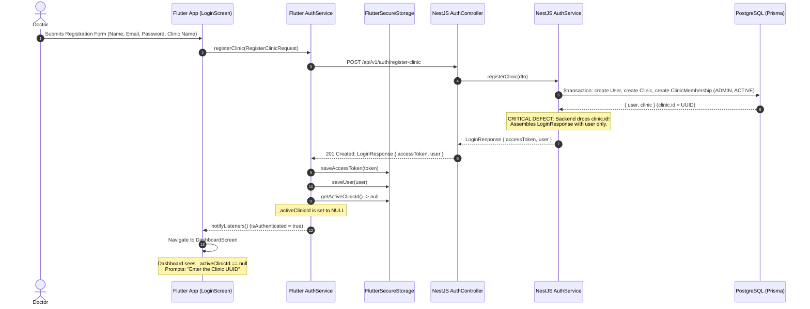
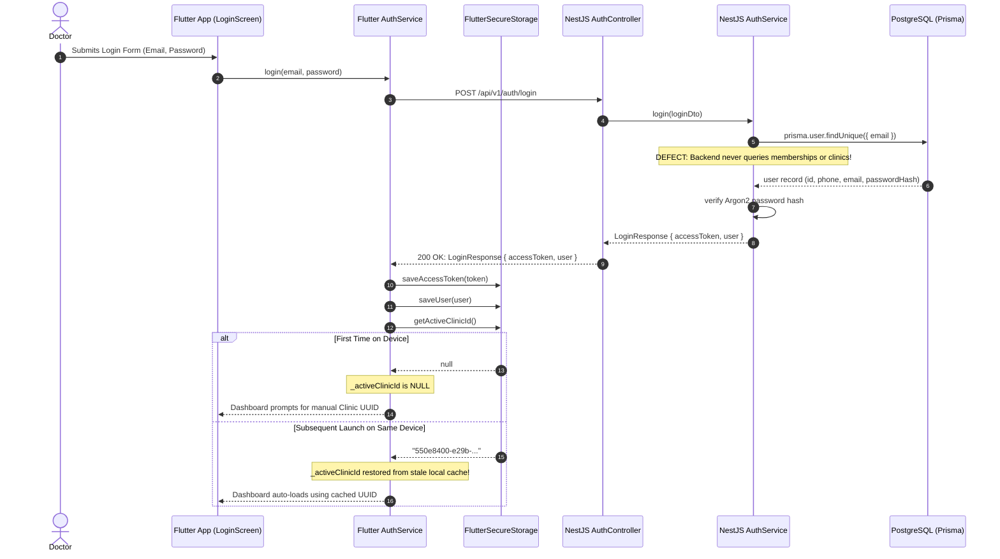
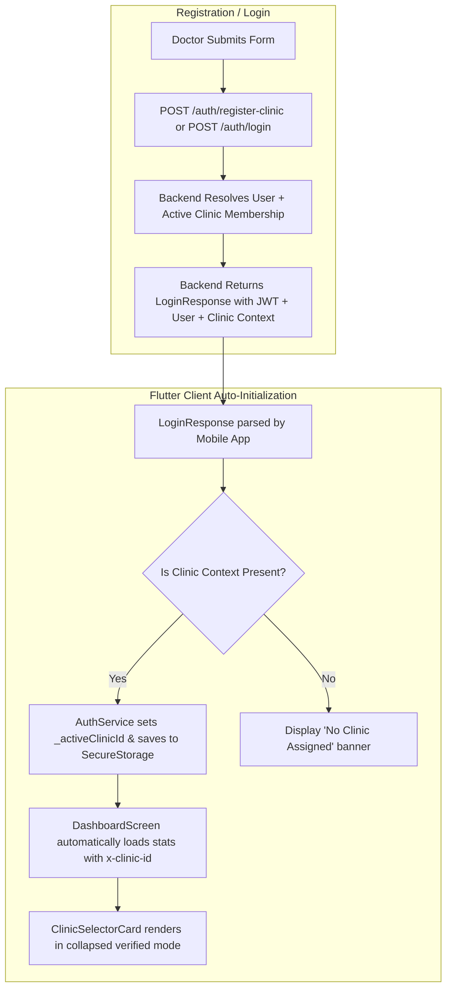

# DOCTOR-OPD — CLINIC ID FIRST-TIME AUTO-FETCH FAILURE
## Phase 1: End-to-End Forensic Audit & Root Cause Analysis

**Audit Date:** 2026-11-07T03:15:00+05:30  
**Repository:** `E:\doctor-opd`  
**Investigation Mode:** STRICT READ-ONLY FORENSIC AUDIT  
**Status:** **ROOT CAUSE CONFIRMED**  

---

## 1. EXECUTIVE SUMMARY

An end-to-end forensic investigation was conducted to determine why a doctor registering or logging into DOCTOR-OPD for the first time is prompted to manually enter a 36-character hexadecimal Clinic UUID into a `ClinicSelectorCard` on the dashboard, while subsequent application launches automatically retrieve the ID without user intervention.

### Core Finding
The problem is caused by an **architectural contract omission across the authentication layer**:
1. **Backend Drops Clinic Context on Registration:** The backend endpoint `POST /api/v1/auth/register-clinic` successfully creates the `User`, the `Clinic`, and an `ACTIVE ADMIN` `ClinicMembership` in PostgreSQL within a single atomic transaction. However, `AuthService.registerClinic()` immediately discards `result.clinic` and returns a standard `LoginResponse` containing only JWT tokens and the `User` object.
2. **Backend Ignores Clinic Memberships on Login:** The backend endpoint `POST /api/v1/auth/login` queries only the PostgreSQL `users` table and never queries `clinic_memberships` or `clinics`.
3. **No Secondary Clinic-Context Endpoint Exists:** The NestJS API contains **zero** endpoints (such as `GET /auth/me`, `GET /clinics/me`, or `GET /users/me/clinics`) through which an authenticated client can query the doctor's associated clinic context.
4. **Client Relies Exclusively on Local Storage:** Flutter `AuthService.login()` and `registerClinic()` do not receive clinic context from the API and attempt to populate `_activeClinicId` strictly by reading `SecureStorageService.getActiveClinicId()`. On a fresh installation, this key (`opd_active_clinic_id`) is empty.
5. **Fallback to Manual Entry:** `DashboardScreen` detects `_activeClinicId == null` and renders `ClinicSelectorCard` with an active `TextField` titled `Clinic UUID`, requiring the doctor to manually input the raw PostgreSQL `clinics.id` UUID.
6. **Masked on Subsequent Sessions:** Once manually entered and saved, the UUID is written to `FlutterSecureStorage`. Furthermore, `AuthService.logout()` intentionally preserves `opd_active_clinic_id` by passing `clearClinic: false`. Consequently, subsequent app launches and logins on the same device retrieve the previously saved UUID from local device storage, masking the underlying architectural defect.

---

## 2. ACTUAL CLINIC ID DATA MODEL AND OWNERSHIP

### Data Model Architecture (Prisma Schema: `apps/api/prisma/schema.prisma`)

```prisma
model User {
  id           String             @id @default(uuid())
  phone        String             @unique
  email        String?            @unique
  passwordHash String?
  fullName     String
  isActive     Boolean            @default(true)
  memberships  ClinicMembership[]
  @@map("users")
}

model Clinic {
  id          String             @id @default(uuid())
  name        String
  slug        String?            @unique
  address     String?
  isActive    Boolean            @default(true)
  memberships ClinicMembership[]
  patients    Patient[]
  @@map("clinics")
}

model ClinicMembership {
  id        String           @id @default(uuid())
  userId    String
  clinicId  String
  role      ClinicRole       @default(STAFF)
  status    MembershipStatus @default(ACTIVE)

  user   User   @relation(fields: [userId], references: [id], onDelete: Cascade)
  clinic Clinic @relation(fields: [clinicId], references: [id], onDelete: Cascade)

  @@unique([userId, clinicId])
  @@index([userId])
  @@index([clinicId])
  @@map("clinic_memberships")
}
```

### Identifier Classification & Clarification

| Term | Technical Entity / Source | Purpose | Manually Entered? |
| :--- | :--- | :--- | :--- |
| **Clinic ID (`clinicId`)** | `clinics.id` (UUIDv4 in PostgreSQL) | **Tenant boundary identifier.** Scopes all patient records, consultations, and prescriptions. Verified by `ClinicAuthGuard`. | **YES (The exact identifier requested in `ClinicSelectorCard`)** |
| **User ID (`userId`)** | `users.id` (UUIDv4 in PostgreSQL) | Identity identifier of the authenticated clinician. Encoded in JWT `sub`. | No (derived from JWT) |
| **Doctor / Clinician ID** | `users.id` acting with `ClinicRole.DOCTOR` | Professional role identity in clinical consultations. | No |
| **Patient UHID** | `patients.uhid` (`UHID-YYYY-XXXX`) | Formatted unique hospital identification number for patients. | No (generated by `PatientUhidCounter`) |

---

## 3. CURRENT REGISTRATION WORKFLOW



### Step-by-Step Execution:
1. **Flutter Form:** `apps/mobile/lib/features/auth/ui/login_screen.dart` (lines 82–105):
   `_handleRegister()` constructs `RegisterClinicRequest` with doctor details and `clinicName`.
2. **API Request:** `apps/mobile/lib/features/auth/services/auth_service.dart` (lines 129–136):
   POSTs to `/api/v1/auth/register-clinic`.
3. **Backend Execution:** `apps/api/src/auth/auth.service.ts` (lines 180–220):
   Runs `$transaction` creating:
   - `user`: `User` record
   - `clinic`: `Clinic` record with generated UUID
   - `clinicMembership`: links `userId` and `clinic.id` as `ADMIN` with `ACTIVE` status.
   The transaction returns `{ user, clinic }`.
4. **Backend Response Omission:** `apps/api/src/auth/auth.service.ts` (lines 222–234):
   ```typescript
   const token = await this.signToken(result.user.id, result.user.phone);

   return {
     accessToken: token,
     tokenType: 'Bearer',
     expiresIn: this.config.jwtExpiresIn,
     user: {
       id: result.user.id,
       email: result.user.email,
       fullName: result.user.fullName,
     },
   };
   ```
   **`result.clinic` is completely omitted from the return statement.**
5. **Client Response Processing:** `apps/mobile/lib/features/auth/services/auth_service.dart` (lines 138–149):
   - Saves token and user.
   - Executes:
     ```dart
     try {
       _activeClinicId = await _storageService.getActiveClinicId();
     } catch (_) {
       _activeClinicId = null;
     }
     ```
   - Because `getActiveClinicId()` reads `opd_active_clinic_id` which does not yet exist, `_activeClinicId` becomes `null`.
6. **Navigation:** `apps/mobile/lib/app.dart` (lines 56–61) routes to `DashboardScreen`.
7. **Failure UI:** `apps/mobile/lib/features/dashboard/ui/dashboard_screen.dart` renders `ClinicSelectorCard` with an empty text box prompting the doctor to supply their Clinic UUID manually.

---

## 4. CURRENT LOGIN WORKFLOW



### Step-by-Step Execution:
1. `apps/api/src/auth/auth.service.ts` (lines 90–130):
   `login()` executes:
   ```typescript
   const user = await this.prisma.user.findUnique({
     where: { email: normalizedEmail },
     select: {
       id: true,
       phone: true,
       email: true,
       fullName: true,
       isActive: true,
       passwordHash: true,
     },
   });
   ```
   It does not join or query `clinic_memberships`.
2. The response contains only `accessToken`, `tokenType`, `expiresIn`, and `user`.
3. In `apps/mobile/lib/features/auth/services/auth_service.dart` (lines 92–96):
   `_activeClinicId` is queried from `_storageService.getActiveClinicId()`.
4. If the key exists from a previous session on that device, it is restored. If it is a fresh device or fresh install, it is `null`.

---

## 5. BACKEND CLINIC CREATION & ASSOCIATION WORKFLOW

1. **Transaction Isolation:** In `AuthService.registerClinic()`, clinic creation and membership creation occur inside `prisma.$transaction(async (tx) => ...)`.
2. **ACID Guarantees:**
   - The user record is created first.
   - The clinic record is created second.
   - The clinic membership is created third with `role: ClinicRole.ADMIN` and `status: MembershipStatus.ACTIVE`.
3. **Availability:** The relationship is committed to PostgreSQL before HTTP 201 is returned.
4. **Endpoint Absence:** A full search of `apps/api/src/` confirms that **no endpoint exists in the entire backend to list, get, or resolve the authenticated user's clinics**.

---

## 6. FLUTTER CLINIC ID INITIALIZATION WORKFLOW

1. **State Ownership:** `_activeClinicId` is held in memory in `AuthService` (`apps/mobile/lib/features/auth/services/auth_service.dart:16`).
2. **Read Methods:**
   - `AuthService.activeClinicId` (getter)
   - `AuthService.getActiveClinicId()` (async fallback to storage)
   - `SecureStorageService.getActiveClinicId()`
   - `AuthInterceptor.onRequest()` (reads storage and injects `x-clinic-id: <id>` into every outgoing HTTP request)
3. **Write Methods:**
   - `AuthService.setActiveClinic(String clinicId)` (line 169)
   - `SecureStorageService.saveActiveClinicId(String clinicId)` (line 37)
4. **Where `setActiveClinic()` is Invoked:**
   Across the entire Flutter mobile codebase, `setActiveClinic()` is called in **only one place**:
   `apps/mobile/lib/features/dashboard/ui/dashboard_screen.dart` (line 182) inside `_handleSaveClinicId(String newClinicId)`:
   ```dart
   Future<void> _handleSaveClinicId(String newClinicId) async {
     final trimmed = newClinicId.trim();
     if (trimmed.isEmpty) return;

     await widget.authService.setActiveClinic(trimmed);
     setState(() {
       _activeClinicId = trimmed;
     });
     await _loadDashboardData(trimmed);
     ...
   }
   ```
5. **UI Trigger:** `_handleSaveClinicId` is the callback passed to `ClinicSelectorCard` (`clinic_selector_card.dart:69`), which is triggered **only when the doctor types into the text field and clicks "Save"**.

---

## 7. LOCAL STORAGE BEHAVIOR

- **Technology:** `FlutterSecureStorage` (wrapped by `SecureStorageService` at `apps/mobile/lib/core/storage/secure_storage_service.dart`).
- **Android Implementation:** EncryptedSharedPreferences with Android Keystore (`resetOnError: true`).
- **Storage Keys:**
  - `opd_access_token`: JWT token.
  - `opd_cached_user`: Serialized `AuthUser` JSON.
  - `opd_active_clinic_id`: Selected Clinic UUID.
- **Why First-Time Setup Fails:**
  At first install, `opd_active_clinic_id` is null. The application never sets it because neither the login nor registration APIs provide it, and no auto-fetch mechanism exists.
- **Why Subsequent Sessions Succeed:**
  Once manually entered, `saveActiveClinicId()` persists it to secure storage.
- **Logout Retention Behavior:**
  `apps/mobile/lib/core/storage/secure_storage_service.dart` (lines 66–75):
  ```dart
  /// Clears authentication tokens and cached user data (logout).
  /// Preserves the selected active clinic identifier across logout sessions by default,
  /// ensuring that clinical devices retain their configured clinic context.
  Future<void> clearAuth({bool clearClinic = false}) async {
    await _storage.delete(key: _keyAccessToken);
    await _storage.delete(key: _keyCachedUser);
    if (clearClinic) {
      await _storage.delete(key: _keyActiveClinicId);
    }
  }
  ```
  `AuthService.logout()` calls `_storageService.clearAuth(clearClinic: false)`. The active clinic ID is intentionally kept in storage across logouts. When the user logs in again, line 93 of `auth_service.dart` reads the old clinic ID back into memory.

---

## 8. API CONTRACT COMPARISON

### Backend `LoginResponse` (`apps/api/src/auth/interfaces/auth.interfaces.ts:35-44`):
```typescript
export interface LoginResponse {
  accessToken: string;
  tokenType: string;
  expiresIn: string;
  user: {
    id: string;
    email: string | null;
    fullName: string;
  };
}
```

### Mobile `LoginResponse` (`apps/mobile/lib/features/auth/models/login_response.dart:4-36`):
```dart
class LoginResponse {
  final String accessToken;
  final String tokenType;
  final String expiresIn;
  final AuthUser user;
}
```

### Contrast & Discrepancy:
- The backend DTO and Flutter model match each other, but **neither includes clinic context**.
- Even though `registerClinic` creates a `Clinic` with an `id`, `name`, and `role`, that information is stripped before sending HTTP 201.
- Even though `login` authenticates a user whose memberships are active in PostgreSQL, that information is never loaded or returned.

---

## 9. END-TO-END EXECUTION TRACES (SCENARIOS 1–6)

### SCENARIO 1: Fresh Installation → Registration → Authentication → Dashboard
1. Fresh app install (secure storage is empty).
2. Doctor fills registration form on `LoginScreen` (Tab 2).
3. `authService.registerClinic()` sends `POST /api/v1/auth/register-clinic`.
4. Backend creates `User`, `Clinic`, and `ClinicMembership` in PostgreSQL.
5. Backend responds with `201 Created` containing `LoginResponse` (tokens + user, **no clinic**).
6. Flutter `AuthService` saves token and user. Reads `getActiveClinicId()` -> returns `null`.
7. `DoctorOpdApp` navigates to `DashboardScreen`.
8. `_initializeDashboard()` resolves `clinicId = null`.
9. `ClinicSelectorCard` renders in editing mode with input label `Clinic UUID`.
10. **Result:** Blocked waiting for manual entry of a UUID the doctor was never shown.

### SCENARIO 2: Existing Account → Login on New Device → Dashboard
1. Doctor logs in with email and password on a fresh device.
2. `authService.login()` sends `POST /api/v1/auth/login`.
3. Backend verifies password, signs JWT, returns `LoginResponse` (**no clinic**).
4. Flutter `AuthService` saves token and user. Reads `getActiveClinicId()` from storage -> `null`.
5. `DashboardScreen` resolves `clinicId = null`.
6. `ClinicSelectorCard` renders manual input field.
7. **Result:** Manual entry required despite valid existing backend clinic membership.

### SCENARIO 3: App Restart → Token Restoration → Dashboard
1. Doctor previously typed and saved Clinic UUID on this device.
2. Device restarts or app process restarts.
3. `authService.initialize()` runs:
   - Reads `opd_access_token` (valid).
   - Reads `opd_cached_user` (valid).
   - Reads `opd_active_clinic_id` (contains previously saved UUID).
4. `DoctorOpdApp` sees `isAuthenticated == true`.
5. `DashboardScreen` initializes with `_activeClinicId = storedUuid`.
6. `_loadDashboardData()` sends `GET /patients` with `x-clinic-id: storedUuid`.
7. `ClinicAuthGuard` validates membership in database: 200 OK.
8. **Result:** Dashboard displays normally without asking for manual input.

### SCENARIO 4: Logout → Login with Another Account
1. Doctor A (Clinic A) logs out: `clearAuth(clearClinic: false)`.
2. Secure storage keeps `opd_active_clinic_id = Clinic_A_UUID`.
3. Doctor B (Clinic B) logs in on the same device.
4. `authService.login()` restores `_activeClinicId = Clinic_A_UUID` from un-cleared storage!
5. `DashboardScreen` calls `GET /patients` with Doctor B's JWT and `x-clinic-id: Clinic_A_UUID`.
6. `ClinicAuthGuard` checks `clinic_memberships` for `(Doctor_B_id, Clinic_A_id)` -> NOT FOUND.
7. Backend responds: `403 Forbidden: Access denied: user is not a member of the requested clinic`.
8. `DashboardScreen` catches 403, sets `_clinicValidationError`, and reopens `ClinicSelectorCard` in editing mode.
9. **Result:** Cross-tenant leakage of cached clinic selector, causing unexpected 403 authorization error.

### SCENARIO 5: Backend Returns No Clinic Association
1. User account exists (e.g. system operator or user with revoked membership), but has 0 active clinic memberships.
2. Current behavior: Since no clinic context is returned, UI prompts for Clinic UUID. If user inputs any UUID, backend throws 403.
3. Expected behavior: Backend explicitly returns `clinic: null` (or `clinics: []`). Client displays a clear state: "No active clinic associated with this account. Please contact your clinic administrator."

### SCENARIO 6: Backend Unavailable During Startup
1. App restarts offline with valid token and cached clinic ID in secure storage.
2. `AuthService.initialize()` restores local session and cached clinic ID.
3. `DashboardScreen` attempts `_loadDashboardData()`. Network fails (`DioException`).
4. Dashboard catches error and displays offline error banner with `Retry` button, while preserving the clinic context.

---

## 10. CONFIRMED ROOT CAUSE

### Statement of Confirmed Root Cause:
The root cause is a **complete absence of Clinic context in the authentication response contracts and absence of a clinic-context query endpoint on the backend, combined with Flutter's exclusive reliance on un-seeded phone-local storage for Clinic ID resolution.**

Specifically:
1. **`apps/api/src/auth/auth.service.ts` line 222 (`registerClinic`):** Drops `result.clinic` and serializes only `user` and `accessToken`.
2. **`apps/api/src/auth/auth.service.ts` line 90 (`login`):** Does not query `clinicMembership` or include clinic context in `LoginResponse`.
3. **`apps/api/src/auth/interfaces/auth.interfaces.ts` line 35 (`LoginResponse`):** Interface omits clinic properties.
4. **`apps/api/src/` (entire backend):** No endpoint exists for an authenticated user to fetch their associated clinics.
5. **`apps/mobile/lib/features/auth/services/auth_service.dart` lines 93 & 146:** Populates `_activeClinicId` solely from `SecureStorageService.getActiveClinicId()`, which is empty on initial run.
6. **`apps/mobile/lib/features/dashboard/ui/widgets/clinic_selector_card.dart` lines 35–37:** Switches to editing mode whenever `widget.activeClinicId == null`, displaying the manual UUID text input field.

---

## 11. CONTRIBUTING FACTORS

1. **Misconception of "Device-Centric Provisioning":** Comments in `secure_storage_service.dart:67` state that clinic ID is preserved across logouts so "clinical devices retain their configured clinic context". This assumed manual clinic setup on the device rather than dynamic resolution for the logged-in doctor.
2. **Missing `ClinicsModule` / User Profile Context:** DOCTOR-OPD decommissioned several modules, but never implemented a user profile or clinic context endpoint (`GET /api/v1/auth/me` or `GET /api/v1/clinics`).
3. **Multi-Tenant Header Requirement vs Client Knowledge:** `ClinicAuthGuard` strictly requires `x-clinic-id` on every protected request, but the backend never gave the client the ID needed to supply that header.

---

## 12. SECURITY & TENANT ISOLATION REVIEW

1. **Backend Validation Integrity:** `ClinicAuthGuard` (`apps/api/src/auth/guards/clinic-auth.guard.ts`) is secure and robust:
   - Does NOT trust `x-clinic-id` merely because the client sent it.
   - Queries `clinic_memberships` in PostgreSQL for the composite key `(userId, clinicId)`.
   - Rejects non-members with 403 Forbidden.
   - Rejects non-active statuses (`INVITED`, `SUSPENDED`) with 403 Forbidden.
2. **Tenant Isolation Finding:** Automatically providing the doctor's legitimate associated Clinic ID upon login/registration does **NOT** weaken tenant isolation. The backend already enforces that only members can access that tenant.
3. **Storage Security Flaw Identified:** Storing `opd_active_clinic_id` as a global un-scoped key across logout sessions creates tenant-cross contamination when different doctors share a device. `clearAuth()` must clear `opd_active_clinic_id` on logout unless explicitly configured otherwise.

---

## 13. EXACT FILES REQUIRING CHANGES (FOR FUTURE IMPLEMENTATION PHASE)

### Backend (`apps/api`):
1. `apps/api/src/auth/interfaces/auth.interfaces.ts`:
   - Expand `LoginResponse` to include `clinic?: { id: string; name: string; role: ClinicRole } | null;` (or `clinics?: Array<...>;`).
2. `apps/api/src/auth/auth.service.ts`:
   - In `registerClinic()`: include `clinic: { id: result.clinic.id, name: result.clinic.name, role: ClinicRole.ADMIN }` in the returned `LoginResponse`.
   - In `login()`: query the user's active membership in `prisma.user.findUnique` via `memberships: { where: { status: 'ACTIVE' }, include: { clinic: true }, take: 1 }` and attach the clinic details to `LoginResponse`.
   - Add a `GET /api/v1/auth/me` endpoint in `auth.controller.ts` returning current user profile and active clinic memberships.

### Mobile (`apps/mobile`):
1. `apps/mobile/lib/features/auth/models/login_response.dart`:
   - Add `clinic` model parsing (`clinicId`, `clinicName`, `role`).
2. `apps/mobile/lib/features/auth/services/auth_service.dart`:
   - In `registerClinic()` and `login()`: if `loginResponse.clinic != null`, immediately call `setActiveClinic(loginResponse.clinic!.id)`.
   - Clear active clinic context on logout to prevent cross-account leakage.
3. `apps/mobile/lib/features/dashboard/ui/dashboard_screen.dart`:
   - If `_activeClinicId` is automatically populated from `AuthService`, dashboard loads seamlessly without showing the manual UUID input card.
4. `apps/mobile/lib/core/storage/secure_storage_service.dart`:
   - Ensure `clearAuth()` cleans up user-specific clinic cache on logout.

---

## 14. RECOMMENDED MINIMAL FIX ARCHITECTURE



### Key Architectural Principles:
1. **Backend is Single Source of Truth:** The backend resolves and returns the primary clinic association upon authentication.
2. **Zero Manual Entry:** The doctor never sees a raw UUID input field during standard registration or login.
3. **Tenant Security Preserved:** `ClinicAuthGuard` continues verifying all requests against PostgreSQL `clinic_memberships`.
4. **Clean Session Boundary:** Logout resets active clinic state, preventing account cross-contamination on shared hardware.

---

## 15. REGRESSION TEST PLAN

1. **Unit Tests (Backend):**
   - `auth.service.spec.ts`: Verify `registerClinic()` returns `clinic.id`, `clinic.name`, `clinic.role`.
   - `auth.service.spec.ts`: Verify `login()` for a user with active membership returns `clinic.id`.
   - `auth.service.spec.ts`: Verify `login()` for a user with no membership returns `clinic: null`.
2. **Unit Tests (Flutter):**
   - `auth_service_test.dart`: Verify `registerClinic()` saves returned `clinicId` to `SecureStorageService` and populates `activeClinicId`.
   - `auth_service_test.dart`: Verify `login()` saves returned `clinicId` and populates `activeClinicId`.
   - `dashboard_screen_test.dart`: Verify `DashboardScreen` automatically fetches stats and remains collapsed when `activeClinicId` is provided by `AuthService`.
3. **E2E Integration Test:**
   - Execute registration -> immediately call `/patients` with token and auto-resolved `x-clinic-id` -> verify 200 OK without manual intervention.

---

## 16. RISKS AND DEPENDENCIES

- **Risk:** Existing tests expecting old `LoginResponse` shape without `clinic`.  
  *Mitigation:* Keep `clinic` optional/nullable in DTO contracts so existing unit tests pass without breakage.
- **Risk:** Multiple clinic memberships for a single doctor in the future.  
  *Mitigation:* Return primary active clinic object in `clinic` and full list in `clinics: [...]`. In DOCTOR-OPD's single-doctor practice model, the primary active clinic is selected automatically.

---

## 17. FINAL STATUS VERDICT

# ROOT CAUSE CONFIRMED

The root cause has been conclusively identified with full file and line traceability. No files have been modified. All findings are ready for review and implementation authorization.

